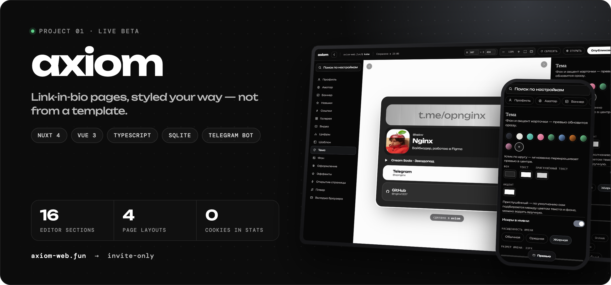
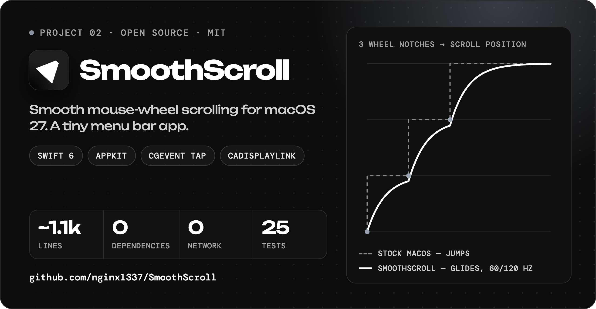
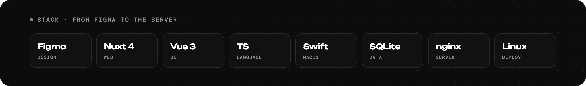

<picture>
  <source media="(prefers-color-scheme: dark)" srcset="banner-dark.png">
  
</picture>

  I design in Figma and ship it end to end — from the mockup to the server. 
  Придумываю в Figma и собираю сам — от макета до сервера.

  <a href="https://axiom-web.fun"><b>axiom-web.fun</b></a> &nbsp;·&nbsp;
  <a href="https://axiom-web.fun/@kekw">my page</a> &nbsp;·&nbsp;
  <a href="https://t.me/axiomweb">project channel</a> &nbsp;·&nbsp;
  <a href="https://t.me/opnginx">telegram @opnginx</a>

