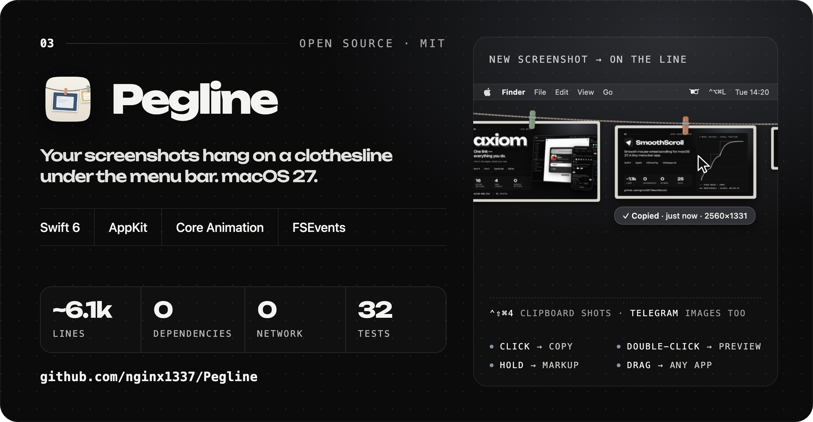

<picture>
  <source media="(prefers-color-scheme: dark)" srcset="banner-dark.png">
  
</picture>

  <a href="https://axiom-web.fun"><b>axiom-web.fun</b></a> &nbsp;·&nbsp;
  <a href="https://axiom-web.fun/@kekw">my page</a> &nbsp;·&nbsp;
  <a href="https://t.me/axiomweb">project channel</a> &nbsp;·&nbsp;
  <a href="https://t.me/opnginx">telegram @opnginx</a> &nbsp;·&nbsp;
  <a href="#на-русском">на русском</a>

## Hi, I'm nginx

A vibe coder who designs in Figma and ships the result. I come up with interfaces and build them end to end — layout, frontend, backend, server and deploy. Right now I'm building my own product, **axiom**, solo, and making small tools for macOS on the side.

## axiom

A link-in-bio service. One link in your profile, and behind it everything you do — socials, music, video, work and contacts — styled your way instead of from a template.

- **Editor** — four layouts, backgrounds, fonts, music player, video, gallery; works on desktop and phone
- **Effects** — page entrance, custom cursors, cursor trail, click sounds
- **Stats** — views, clicks and sources, with no cookies and no visitor tracking
- **QR posters** of your page for stories and print
- **Telegram bot** — sign-in alerts, weekly stats, support

Access is **invite-only** for now — invites and news in [t.me/axiomweb](https://t.me/axiomweb).

## SmoothScroll

A tiny menu bar app for macOS 27: every mouse-wheel notch turns into a smooth ease-out glide, synced to your display (60/120 Hz). Trackpads and Magic Mouse are left untouched.

- **Private** — no network, no telemetry, no third-party dependencies
- **Readable** — about 1,100 lines of Swift you can read in one sitting
- **Tunable** — speed, smoothness, acceleration and reverse direction right in the menu
- **Tested** — 25 unit tests for the scrolling core

Source, build steps and settings — [nginx1337/SmoothScroll](https://github.com/nginx1337/SmoothScroll).

## Pegline

A menu bar app for macOS 27: every new screenshot hangs on a thin clothesline right under the menu bar, clipped on with a little peg and gently swaying. Click to copy, double-click for Preview, hold for Markup, drag it into any app.

- **Instant** — picks up new screenshots by itself, including ⌃⇧⌘4 clipboard shots and images copied from Telegram
- **Out of the way** — hides on its own; hold the pointer at the top edge or press ⌃⌥⌘L to bring it back
- **Private** — no network, no telemetry, no dependencies; password-manager items on the clipboard are never read
- **Tested** — 32 unit tests plus a built-in self-check that drives the real app

Source, build steps and how it works — [nginx1337/Pegline](https://github.com/nginx1337/Pegline).

## Islet

A menu bar app for macOS 27: whatever is playing shows up as an island at the top of the screen, like Dynamic Island on iPhone. On a MacBook it grows out of the notch, on an external monitor it floats as a pill. Hover and it expands — big artwork, title, seek bar and controls.

- **Any player** — Music, Spotify, browsers, podcasts, VLC, IINA
- **Live** — the equaliser bars follow the Mac's real sound and take their colour from the artwork
- **Out of the way** — hidden when nothing is playing, dims and hides on pause; ⌃⌥⌘N expands and collapses it
- **Light** — about 0% CPU when idle, no telemetry, no dependencies besides the bundled MediaRemote adapter
- **Tested** — 95 unit tests plus a built-in self-check

Source, build steps and how it works — [nginx1337/Islet](https://github.com/nginx1337/Islet).

## Stack

**Contact** — Telegram [@opnginx](https://t.me/opnginx)

---

## На русском

<b>Открыть описание на русском</b>

### Про меня

Я nginx. Вайбкодер, работаю в Figma. Придумываю интерфейсы и собираю их от начала до конца — макет, фронтенд, бэкенд, сервер и выкладка. Сейчас в одиночку делаю свой сервис **axiom**, а в свободное время — небольшие утилиты для macOS.

### axiom

Сервис страниц «ссылка в био». Одна ссылка в профиле, а за ней всё, что ты делаешь: соцсети, музыка, видео, работы и контакты — в оформлении под себя, а не по шаблону.

- **Редактор** — четыре шаблона, фон, шрифты, плеер, видео, галерея; работает и на компьютере, и на телефоне
- **Эффекты** — появление страницы, свои курсоры, след за курсором, звук нажатия
- **Статистика** — просмотры, клики и источники без cookie и без слежки за посетителями
- **Постеры** с QR-кодом страницы для сторис и печати
- **Telegram-бот** — оповещения о входе, сводка за неделю, поддержка

Доступ пока **по приглашениям** — приглашения и новости в [t.me/axiomweb](https://t.me/axiomweb).

### SmoothScroll

Маленькое приложение в строке меню macOS 27: каждый щелчок колёсика мыши превращается в плавный ход с замедлением в такт экрану (60/120 Гц). Трекпад и Magic Mouse не трогаются.

- **Приватно** — без сети, телеметрии и сторонних зависимостей
- **Прозрачно** — около 1100 строк на Swift, можно прочитать целиком
- **Настраивается** — скорость, плавность, ускорение и обратное направление прямо в меню
- **Проверено** — 25 тестов на ядро прокрутки

Код, сборка и настройки — [nginx1337/SmoothScroll](https://github.com/nginx1337/SmoothScroll).

### Pegline

Приложение в строке меню macOS 27: каждый новый скриншот повисает на тонкой верёвке прямо под строкой меню — на маленькой прищепке, чуть покачиваясь. Клик — скопировать, двойной клик — «Просмотр», удержание — «Разметка», перетаскивание — в любую программу.

- **Сразу** — сам находит новые снимки, в том числе сделанные в буфер обмена (⌃⇧⌘4) и картинки, скопированные из Telegram
- **Не мешает** — прячется сам; задержите курсор у верхнего края экрана или нажмите ⌃⌥⌘L, чтобы вернуть
- **Приватно** — без сети, телеметрии и зависимостей; секреты из менеджеров паролей в буфере не читаются
- **Проверено** — 32 теста и встроенная самопроверка, которая управляет настоящим приложением

Код, сборка и устройство — [nginx1337/Pegline](https://github.com/nginx1337/Pegline).

### Islet

Приложение в строке меню macOS 27: то, что сейчас играет, показывается островом у верхнего края экрана — как Dynamic Island на iPhone. На MacBook остров вырастает из чёлки, на внешнем мониторе это отдельная плавающая «таблетка». Наведите курсор, и он раскроется: крупная обложка, название, перемотка и кнопки.

- **Любой плеер** — «Музыка», Spotify, браузеры, подкасты, VLC, IINA
- **Вживую** — полоски эквалайзера показывают настоящий звук Mac и окрашены в цвет обложки
- **Не мешает** — спрятан, когда ничего не играет, на паузе приглушается и прячется; ⌃⌥⌘N раскрывает и сворачивает
- **Легко** — около 0 % процессора в простое, без телеметрии и зависимостей, кроме встроенного адаптера MediaRemote
- **Проверено** — 95 тестов и встроенная самопроверка

Код, сборка и устройство — [nginx1337/Islet](https://github.com/nginx1337/Islet).

**Связь** — Telegram [@opnginx](https://t.me/opnginx)

