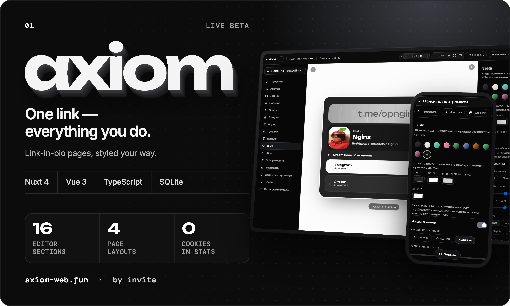
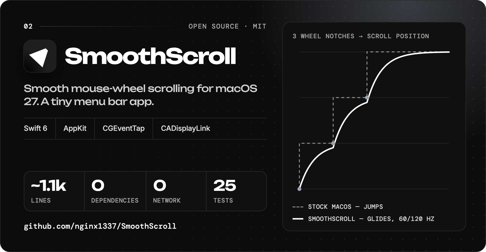
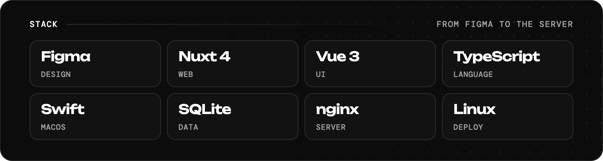

<picture>
  <source media="(prefers-color-scheme: dark)" srcset="banner-dark.png">
  
</picture>

  <a href="https://axiom-web.fun"><b>axiom-web.fun</b></a> &nbsp;·&nbsp;
  <a href="https://axiom-web.fun/@kekw">my page</a> &nbsp;·&nbsp;
  <a href="https://t.me/axiomweb">project channel</a> &nbsp;·&nbsp;
  <a href="https://t.me/opnginx">telegram @opnginx</a> &nbsp;·&nbsp;
  <a href="#на-русском">на русском</a>

## Hi, I'm nginx

A vibe coder who designs in Figma and ships the result. I come up with interfaces and build them end to end — layout, frontend, backend, server and deploy. Right now I'm building my own product, **axiom**, solo, and making small tools for macOS on the side.

## axiom

A link-in-bio service. One link in your profile, and behind it everything you do — socials, music, video, work and contacts — styled your way instead of from a template.

- **Editor** — four layouts, backgrounds, fonts, music player, video, gallery; works on desktop and phone
- **Effects** — page entrance, custom cursors, cursor trail, click sounds
- **Stats** — views, clicks and sources, with no cookies and no visitor tracking
- **QR posters** of your page for stories and print
- **Telegram bot** — sign-in alerts, weekly stats, support

Access is **invite-only** for now — invites and news in [t.me/axiomweb](https://t.me/axiomweb).

## SmoothScroll

A tiny menu bar app for macOS 27: every mouse-wheel notch turns into a smooth ease-out glide, synced to your display (60/120 Hz). Trackpads and Magic Mouse are left untouched.

- **Private** — no network, no telemetry, no third-party dependencies
- **Readable** — about 1,100 lines of Swift you can read in one sitting
- **Tunable** — speed, smoothness, acceleration and reverse direction right in the menu
- **Tested** — 25 unit tests for the scrolling core

Source, build steps and settings — [nginx1337/SmoothScroll](https://github.com/nginx1337/SmoothScroll).

## Stack

**Contact** — Telegram [@opnginx](https://t.me/opnginx)

---

## На русском

<b>Открыть описание на русском</b>

### Про меня

Я nginx. Вайбкодер, работаю в Figma. Придумываю интерфейсы и собираю их от начала до конца — макет, фронтенд, бэкенд, сервер и выкладка. Сейчас в одиночку делаю свой сервис **axiom**, а в свободное время — небольшие утилиты для macOS.

### axiom

Сервис страниц «ссылка в био». Одна ссылка в профиле, а за ней всё, что ты делаешь: соцсети, музыка, видео, работы и контакты — в оформлении под себя, а не по шаблону.

- **Редактор** — четыре шаблона, фон, шрифты, плеер, видео, галерея; работает и на компьютере, и на телефоне
- **Эффекты** — появление страницы, свои курсоры, след за курсором, звук нажатия
- **Статистика** — просмотры, клики и источники без cookie и без слежки за посетителями
- **Постеры** с QR-кодом страницы для сторис и печати
- **Telegram-бот** — оповещения о входе, сводка за неделю, поддержка

Доступ пока **по приглашениям** — приглашения и новости в [t.me/axiomweb](https://t.me/axiomweb).

### SmoothScroll

Маленькое приложение в строке меню macOS 27: каждый щелчок колёсика мыши превращается в плавный ход с замедлением в такт экрану (60/120 Гц). Трекпад и Magic Mouse не трогаются.

- **Приватно** — без сети, телеметрии и сторонних зависимостей
- **Прозрачно** — около 1100 строк на Swift, можно прочитать целиком
- **Настраивается** — скорость, плавность, ускорение и обратное направление прямо в меню
- **Проверено** — 25 тестов на ядро прокрутки

Код, сборка и настройки — [nginx1337/SmoothScroll](https://github.com/nginx1337/SmoothScroll).

**Связь** — Telegram [@opnginx](https://t.me/opnginx)

